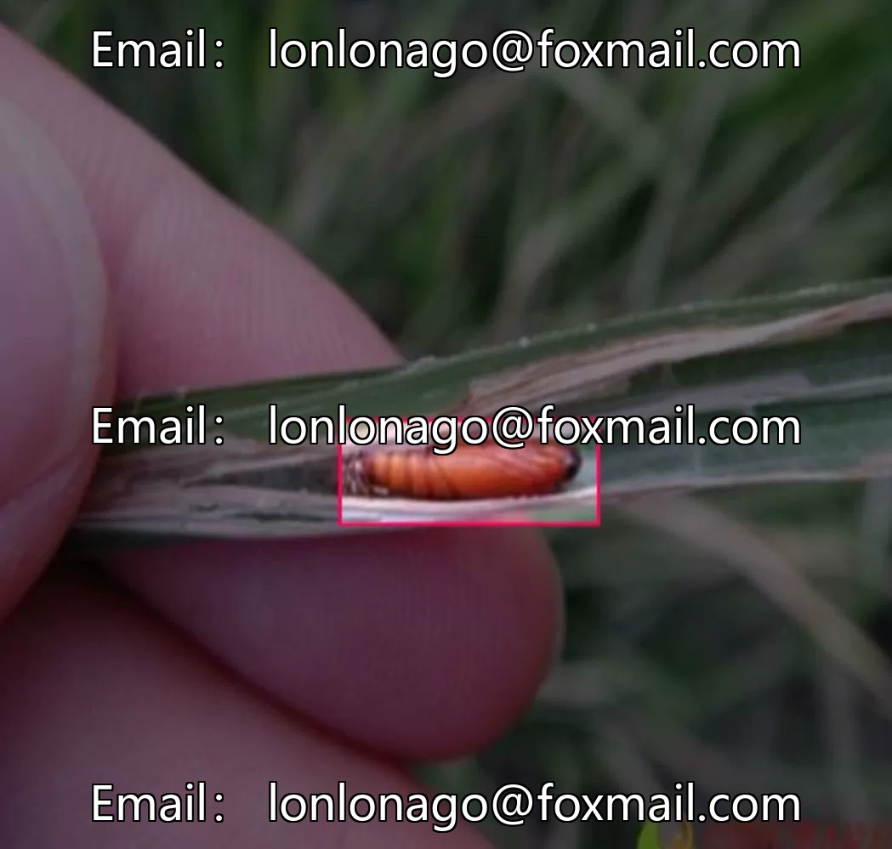
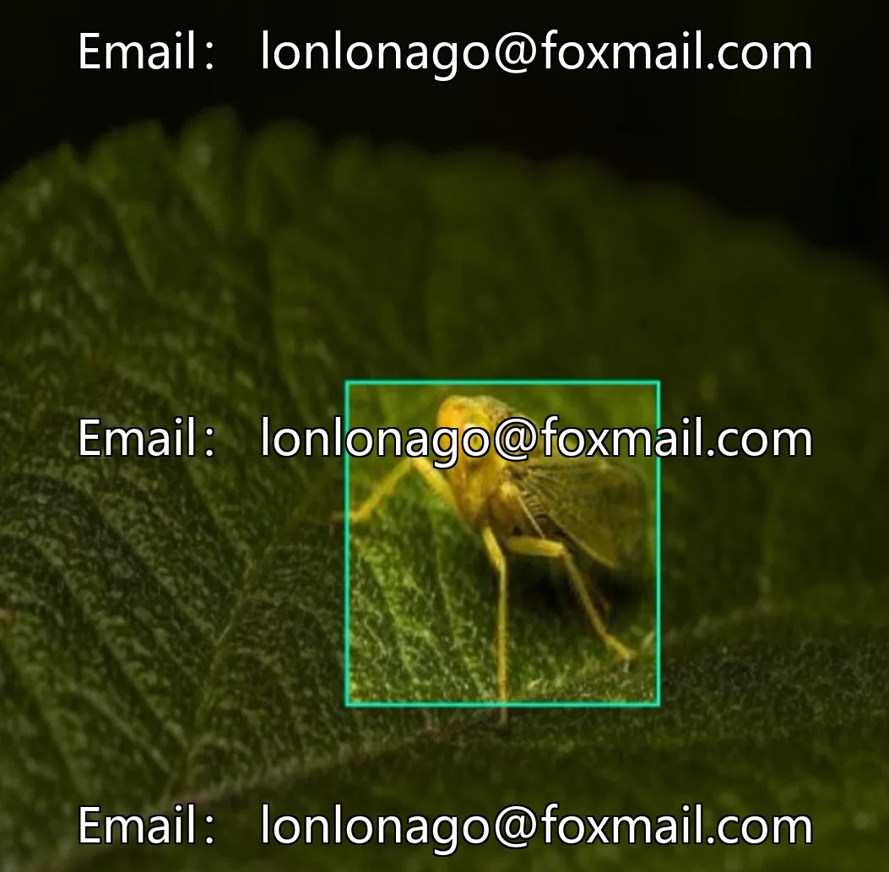
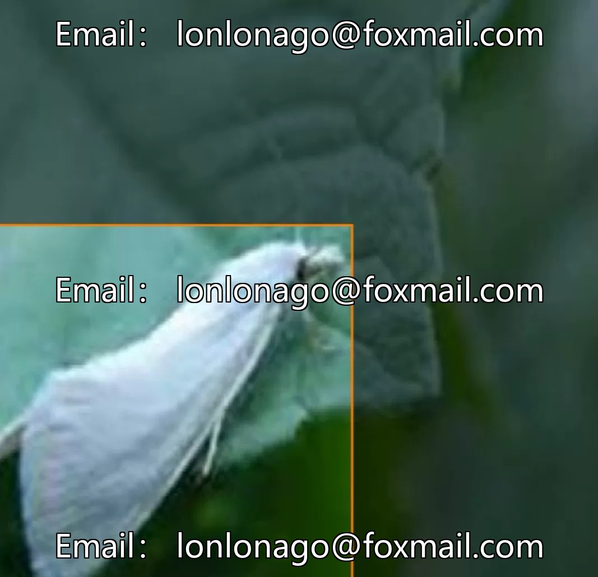
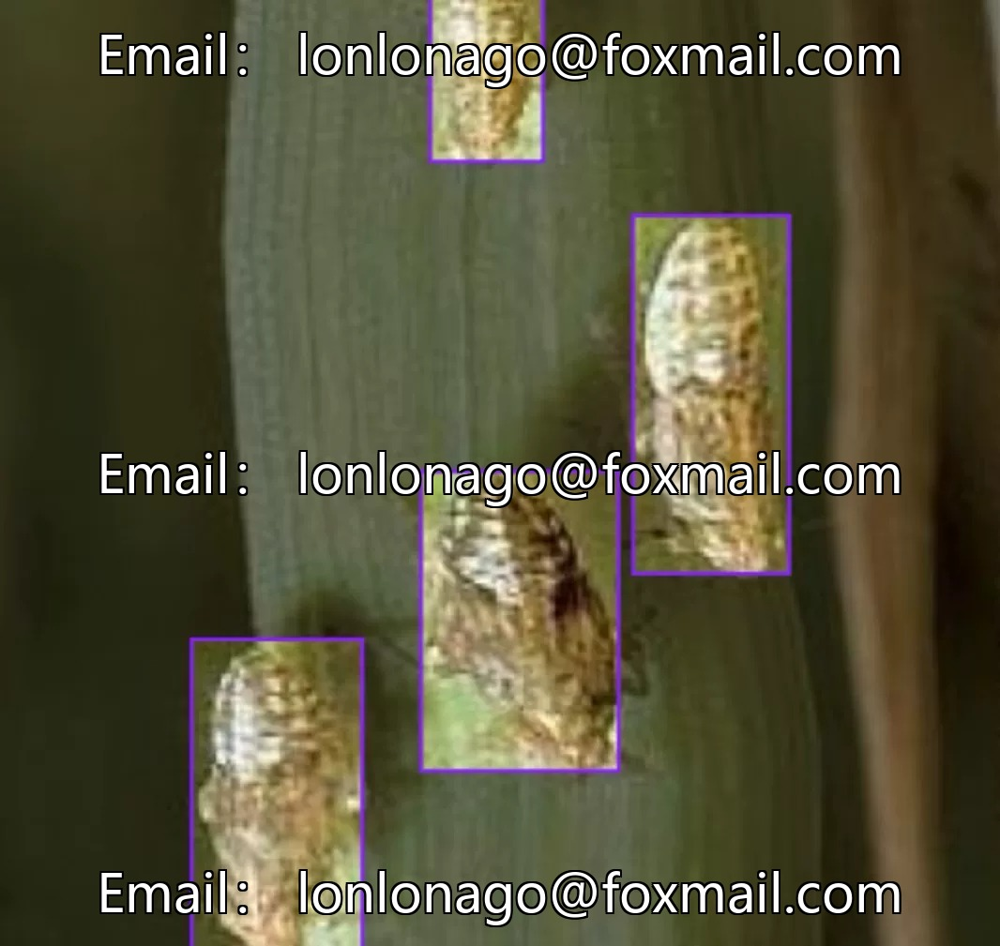
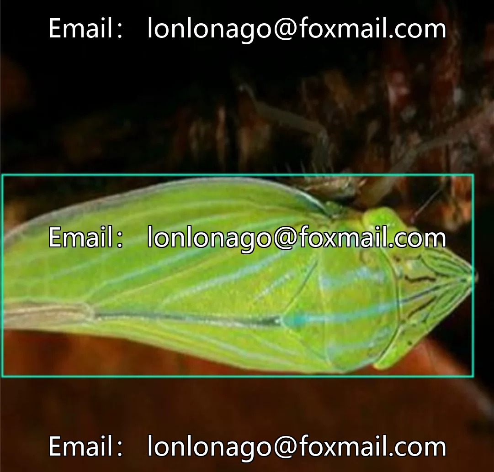

# The Rice Pest and Disease Identification Dataset for Smart Agriculture, containing 5229 images, focusing on rice.

## Body

The Rice Pest and Disease Identification Dataset for Smart Agriculture, comprising 5229 images, focuses on the detection of rice pests and diseases. It includes six subcategories: brown planthopper, green leafhopper, sheath bug, rice stem borer, two-spotted spider mite, and rice root louse. The dataset is formatted in standard computer vision target detection format, suitable for model training and algorithm validation, and supports input by mainstream models such as YOLO.

The data is not associated with the trained model, suitable for basic model development and algorithm testing. The quantity is sufficient, focusing on rice pests and diseases, reducing training interference.

Virtual materials, once sold, are non-refundable.
Interested friends, click "I want" to proceed.

## Images

## Payment

Here is a pay link on Stripe ( https://buy.stripe.com/3cs8yP7sY87d0vu9AB ). Please contact me lonlonago@foxmail.com after funding $89, and I will send you a complete data files , thank you!

